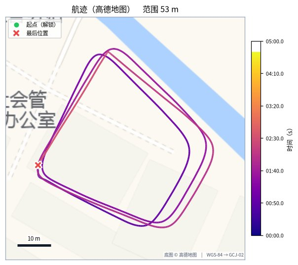
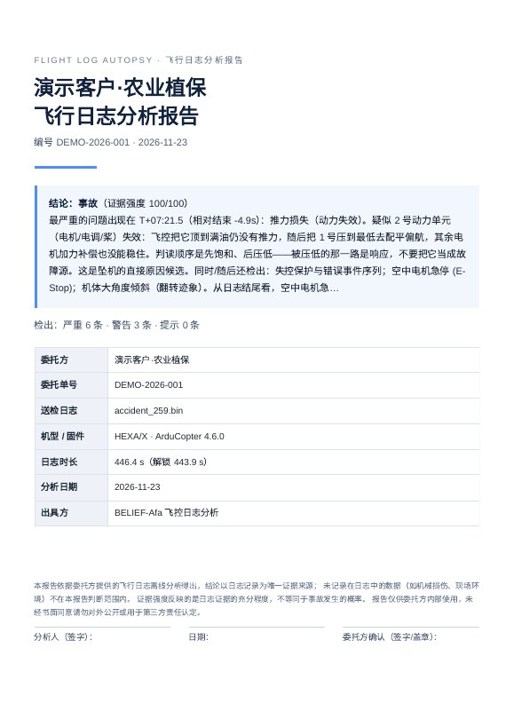

# dsh-flightlog

把 [flightlog-autopsy](../flightlog-autopsy/) 的飞控日志分析能力挂进 **DeepSeek Harness**：
模型可以直接分析 ArduPilot / PX4 日志，得到事故结论、可复核的证据链、调参体检，并落地成
Markdown / HTML / Word 报告与图表。

[](https://github.com/BELIEF-Afa/dsh-flightlog/actions/workflows/ci.yml)
[](LICENSE)
[](https://github.com/BELIEF-Afa/dsh-flightlog/releases)
[](https://github.com/BELIEF-Afa/dsh-flightlog)

```bash
dsh plugin add github:BELIEF-Afa/dsh-flightlog
```

> 装完重启 `dsh web`。首次调用 `flightlog_doctor` 会在 `~/.dsh-flightlog/venv` 自动建环境
> （约 25 秒，之后 0.6 秒），不需要预先装 Python 包。

---

## 它长什么样

| 航迹图（真实坐标 + 高德底图） | 报告封面 |
| --- | --- |
|  |  |

| 3 页「事故速读」（微信直接发） |
| --- |
|  |

航迹图是 `accident_1106`（ArduPilot 样本）：绿点是解锁位置，红叉是最后位置，颜色是时间，
左下角有比例尺，深色点是推力损失 / 急停 / 触地等事件的实际落点。

## 工具

| 工具 | 作用 |
| --- | --- |
| `flightlog_analyze` | 事故/飞行分析：结论、评分、逐条证据（时间 + 证据 + 结论）、调参摘要、航迹摘要；输出 `.md` / `.html` / `.docx` 与图表 |
| `flightlog_tune` | 调参体检：质量门、速率环跟踪、响应延迟/相干度、参数建议 |
| `flightlog_doctor` | 环境自检：用的是哪个 python、fla 在哪、依赖齐不齐 |

报告默认写到**日志同级的 `fla-reports/`**，可用 `outdir` 覆盖。`flightlog_analyze` 的参数：

| 参数 | 说明 |
| --- | --- |
| `log` | 日志路径（相对路径按宿主 cwd → 工作区 → 插件目录依次尝试） |
| `format` | `md` / `html` / `docx` / `all`（默认 `md`） |
| `figures` | 是否画图（默认 `true`） |
| `map` | `amap`（默认，高德）/ `osm` / `off`（本地网格，完全离线） |
| `outdir` | 输出目录 |

## 航迹与地图

| 取值 | 底图 | 说明 |
| --- | --- | --- |
| `amap`（默认） | 高德 | 中国大陆最稳；瓦片是 GCJ-02 坐标，插件自动做 WGS-84 → GCJ-02 逐点纠偏（不纠正会整体偏 100–500 m） |
| `osm` | OpenStreetMap | 海外可用；国内网络常连不通 |
| `off` | 本地网格 | 完全离线：以解锁点为原点的东/北向网格，不给假地点 |

- 图上：线为水平航迹、颜色随时间变化，绿点是解锁位置、红叉是最后位置、深色圆点是
  推力损失 / 急停 / 触地等事件的实际落点，左下角有比例尺。
- 报告里新增「航迹与位置」一章：起点/终点经纬度、最大离起点距离及其时刻、水平航迹总长、
  终点偏移、相对高度范围、以及关键事件的坐标与距起点距离。
- **坐标是日志里的原始 WGS-84 值，不做脱敏**——图上的地点就是真实地点。要对外分享又不想暴露
  场地时，请自行处理（例如把 `outdir` 里含坐标的报告和地图排除）。
- 瓦片缓存在 `~/.cache/fla-tiles`（可用 `FLA_TILE_CACHE` 改），同一地点第二次出图不联网。
  取不到瓦片时自动降级成本地网格，报告不会因此失败。
- 底图版权：高德瓦片 © AutoNavi；OSM 瓦片 © OpenStreetMap contributors（ODbL），
  图上已带署名。**高德栅格接口非公开 API**，个人/小批量使用；对外商业分发请换用其
  官方 API（或换成 `osm` / 自建瓦片服务）。

## 环境探测

插件自己找 fla 源码和解释器，顺序：

1. 环境变量 `FLA_HOME`（fla 项目根目录）、`FLA_PYTHON`（解释器路径）
2. 从宿主 cwd / 插件目录 / 日志路径逐级向上找 `flightlog-autopsy/pyproject.toml` 与 `fla/analyzer.py`
   （开发机上想用工作区里的 fla 源码，就走这一条）
3. 找不到就用自带 wheel 在 `~/.dsh-flightlog/venv` 建一个托管环境（见下节）
4. 每个候选都会先跑一次 `import fla.analyzer, numpy` 验证，能 import 才算数

`flightlog_doctor` 会报告当前用的是哪一条（`source: local | managed | missing`）。

`docx` 导出是 fla 自带的纯标准库实现，不需要 python-docx。

## Word 里的严重度标记

`fla` 的报告在 Markdown 里用 🟥/🟨/🟦 标严重度。Word 没有可靠的彩色 emoji 字体
（WPS / LibreOffice 常把 🟨 渲染成怪字形，比如一个 "K"），所以 **导出 docx 前**
插件会把它们换成中文字体一定有的标签：`【严重】/【警告】/【提示】`。
`.md` 与 `.html` 保留 emoji。

## 依赖怎么来

插件包自带 `wheels/flightlog_autopsy-0.2.0-py3-none-any.whl`；首次调用时在本机建
`~/.dsh-flightlog/venv`，优先用自带 wheel、再补 `matplotlib`（画图用）。
换目录用 `FLA_MANAGED_DIR`；离线环境设 `FLA_NO_BOOTSTRAP=1` 并自行 `pip install` 到
`FLA_PYTHON` 指定的解释器。

`wheels/` 里可能同时存在新旧版本，插件按**版本号**取最新的那个，残留的旧 wheel 不影响安装。

## 来源与许可

- 插件本体 **MIT**；分析引擎 [flightlog-autopsy](../flightlog-autopsy/)（同一作者的 MIT 项目）
  以 wheel 形式随包分发，**未修改源码**。
- 运行时依赖由 pip 装进托管 venv，不随包分发：`pymavlink`（**LGPL-3.0**）、`pyulog`（BSD-3）、
  `numpy`（BSD-3）、`matplotlib`（Matplotlib License）。
- **不含** ArduPilot / PX4 / Betaflight 的源码或二进制；判据来自公开日志字段与固件行为观察，
  结论由本项目代码独立实现。
- 分析全程本机完成，不上传日志。联网动作只有两个：首次自动装依赖（`FLA_NO_BOOTSTRAP=1` 可关）、
  以及画航迹图时按 `z/x/y` 取地图瓦片（`map: off` 可完全离线）。

完整的第三方清单、商标声明与再分发要求见 [NOTICE.md](NOTICE.md)。

## 不支持

- Betaflight 黑匣子 `.bbl` / `.bfl`：先用 `blackbox_decode` 转 CSV 再传。
- `--llm` 叙事（需要 API key）没有暴露；需要时直接在 CLI 里跑。

## 安装（开发）

改 `index.js` 要重启 `dsh web` 才生效；改 `bridge/fla_bridge.py` 下一次调用就生效
（每次调用新起 python 进程）。本机装：

```bash
dsh plugin add /绝对路径/dsh-flightlog
```

架构与调试方法见 [docs/architecture.md](docs/architecture.md)，版本变更见 [CHANGELOG.md](CHANGELOG.md)。
